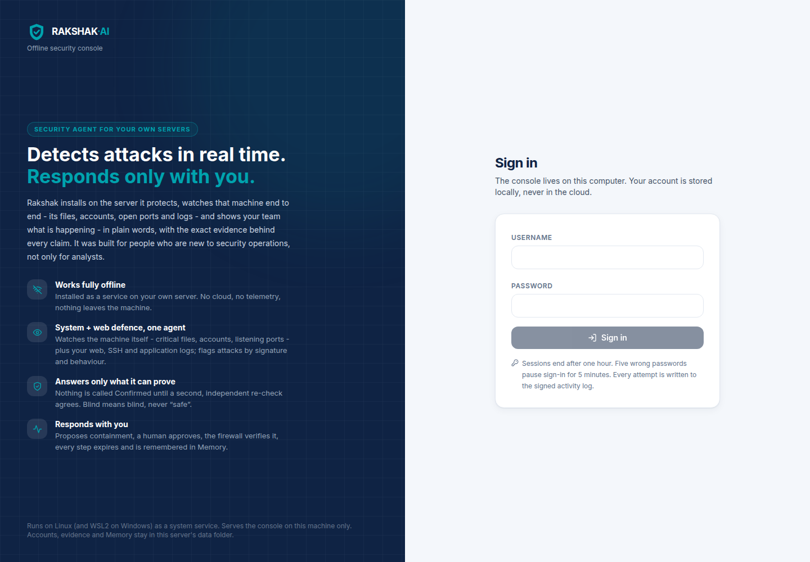
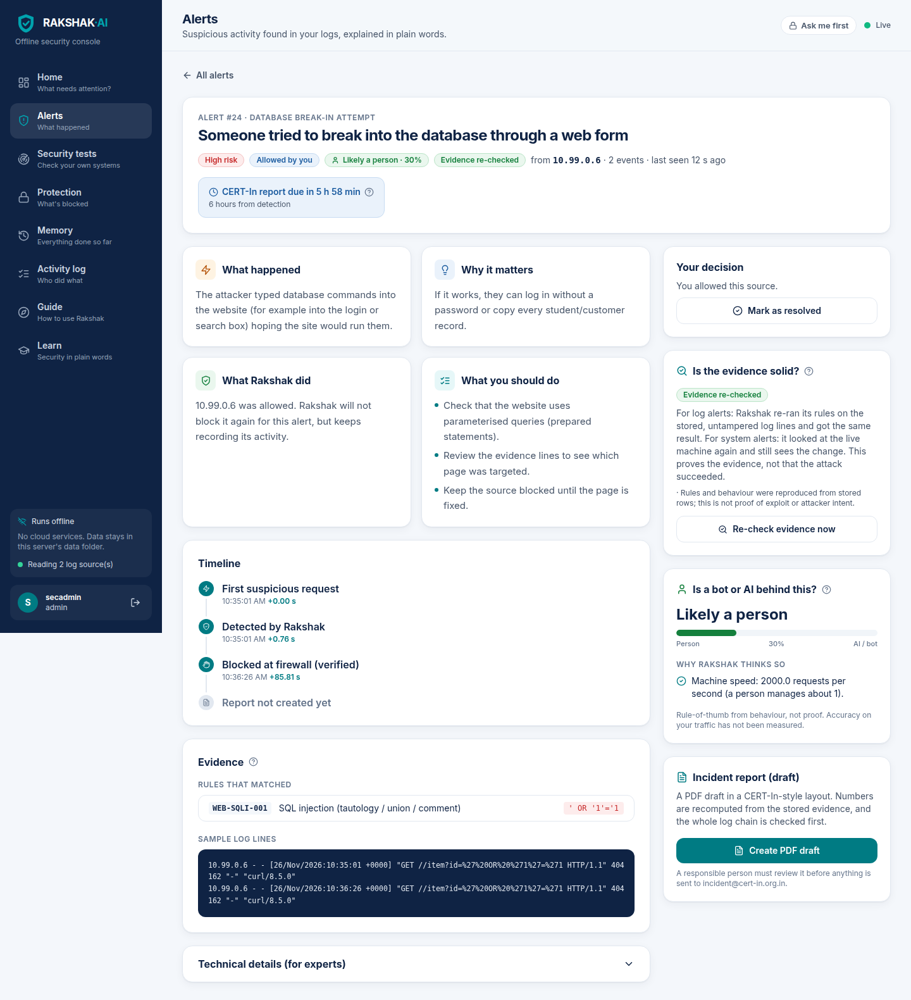
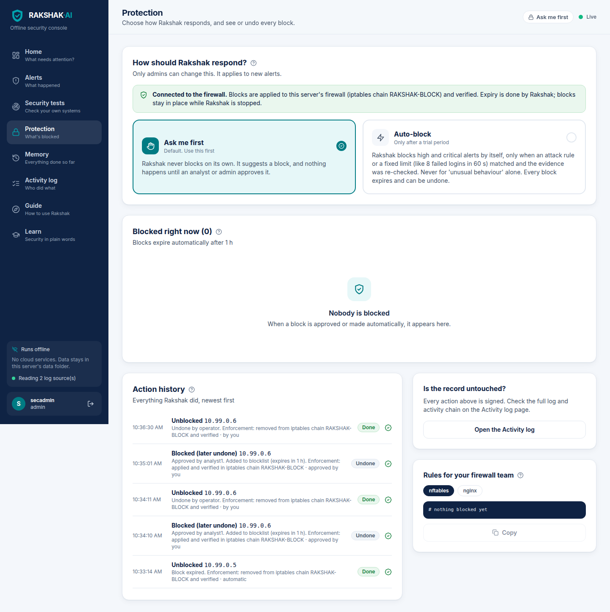
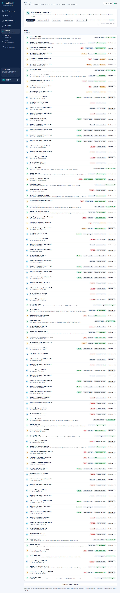

# Real-time response demo: attack -> proposal -> approval -> firewall verification

Run against the sandbox test environment on 2026-11-26 10:36 UTC (`scripts/attack_response_demo.py`).
This is a demonstration on a test network we own: `10.99.0.6` is a source address on this
machine's loopback interface, standing in for an attacker, and the SQL-injection probes are
ordinary attack strings that a real attacker would send. Nothing here is simulated *inside*
Rakshak: the log lines are written by real nginx, detected by the real engine, and the block
is a real iptables rule applied and verified through the root helper.

## What happened, in order

| Time | Step | What we observed |
|---|---|---|
| `+   1.0s` | 0. signed in | admin=secadmin analyst=analyst1 (separate people: approval is not self-approval) |
| `+   1.0s` | 0. baseline: attacker can reach the site | HTTP 200 |
| `+   1.0s` | 0. console state before the attack | mode=recommend state=attention firewall=connected |
| `+   1.0s` | 1. launching attack: 8 SQL-injection probes from | 10.99.0.6 -> http://10.99.0.1:8081/ |
| `+   1.1s` | 2. engine detected the attack | incident #24 sql_injection severity=high status=awaiting_approval lines=1 |
| `+   1.1s` | 2. evidence re-check on the stored lines | validation=evidence_checked |
| `+   1.1s` | 3. Rakshak PROPOSED containment (nothing applied yet) | action #27 target=10.99.0.6 status=proposed detail=Waiting for approval |
| `+   1.1s` | 3. proof the proposal blocks nothing on its own | attacker still gets HTTP 200 |
| `+   1.2s` | 4. analyst approved the proposal | HTTP 200 {'ok': True} |
| `+   1.2s` | 5. applied through the firewall helper | detail=Approved by analyst1. Added to blocklist (expires in 1 h). Enforcement: applied and verified in iptables chain RAKSHAK-BLOCK |
| `+   1.2s` | 5. signature on the action record | verified=True (a signed record: editing it breaks the chain) |
| `+   1.2s` | 5. blocklist entry | {"ip": "10.99.0.6", "reason": "sql_injection", "incident_id": 24, "added_at": 1795689386.809576, "expires_at": 1795692986.711489, "enforced": "enforced"} |
| `+   1.2s` | 5. rule as the kernel sees it | iptables RAKSHAK-BLOCK: -N RAKSHAK-BLOCK | -A RAKSHAK-BLOCK -s 10.99.0.6/32 -j DROP |
| `+   5.3s` | 6. attacker's request now | HTTP 000 (000 = no answer at all) |
| `+   5.3s` | 6. an innocent neighbour's request | HTTP 200 |
| `+   5.3s` | 6. incident status after containment | status=contained contained_at set=True |
| `+   5.4s` | 7. analyst undid the block | HTTP 200 {'ok': True, 'still_blocked': False} |
| `+   5.4s` | 7. attacker can reach the site again | yes |
| `+   5.4s` | 7. rule gone from the chain | iptables RAKSHAK-BLOCK: -N RAKSHAK-BLOCK |
| `+   5.4s` | 8. the whole story is in Memory | [('action', 'done'), ('action', 'undone'), ('alert', 'allowed'), ('alert', 'resolved'), ('alert', 'resolved'), ('alert', 'resolved')] |
| `+   5.4s` | 8. integrity after the exercise | events ok=True audit ok=True |
| `+  18.6s` | 9. dashboard screenshots | 12_landing_page.png, 13_demo_alert_evidence.png, 14_demo_protection.png, 15_demo_memory.png |

## The security promises this run demonstrates

1. **Detection is real.** Eight injection probes from one address produced an incident whose
   evidence (`event_count`, the stored log lines) re-validates against the hash-chained event store.
2. **A proposal is not an action.** In Ask-me-first mode the policy engine records what it *would*
   do and the attacker keeps getting HTTP 200 until a human approves. The traffic test after the
   proposal proves the difference.
3. **Approval has to come from someone else.** The console was signed in as a separate analyst
   account; viewers are refused (the live check asserts the 403).
4. **"Blocked" means proven blocked.** After approval the rule is applied through `deploy/rakshak-fw`
   and confirmed by a separate `iptables -C` check, which is printed above; the attacker then gets no
   answer while an innocent neighbour on the same host is still served - so the containment is real and
   not aimed at everybody.
5. **Everything can be undone and nothing is edited silently.** The undo removes the verified rule,
   service returns, and the whole story sits in Memory plus the signed audit chain, which verified at
   the end of the run.

## Screenshots



*12 landing page*


*13 demo alert evidence*


*14 demo protection*


*15 demo memory*

## Reproduce it

```bash
RAKSHAK_E2E_CREDS=/path/outside/repo/creds.txt \
  python3 scripts/attack_response_demo.py --i-own-this-test-environment
```

**Not a claim about production accuracy:** one attack pattern, on one test host. Detection rate and
false-alarm rate on real traffic still have to be measured (milestone M4 in `ENTERPRISE_PLAN.md`).
