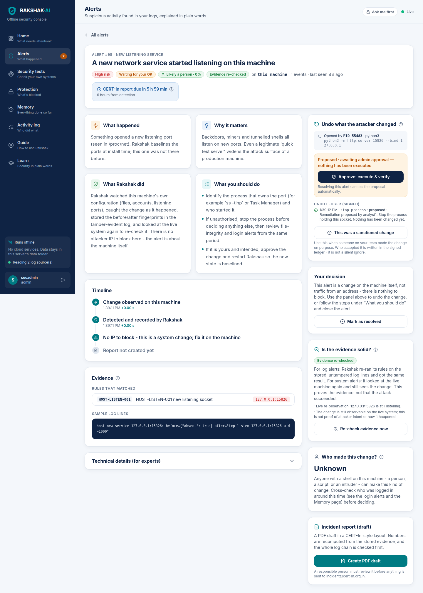
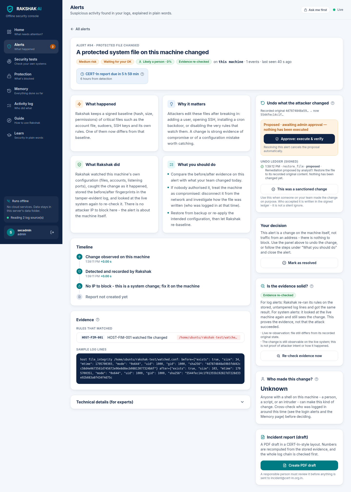
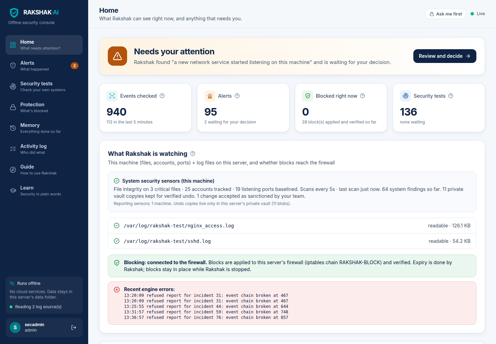
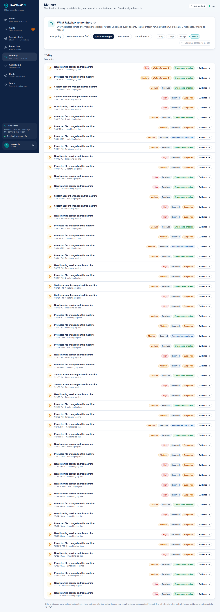
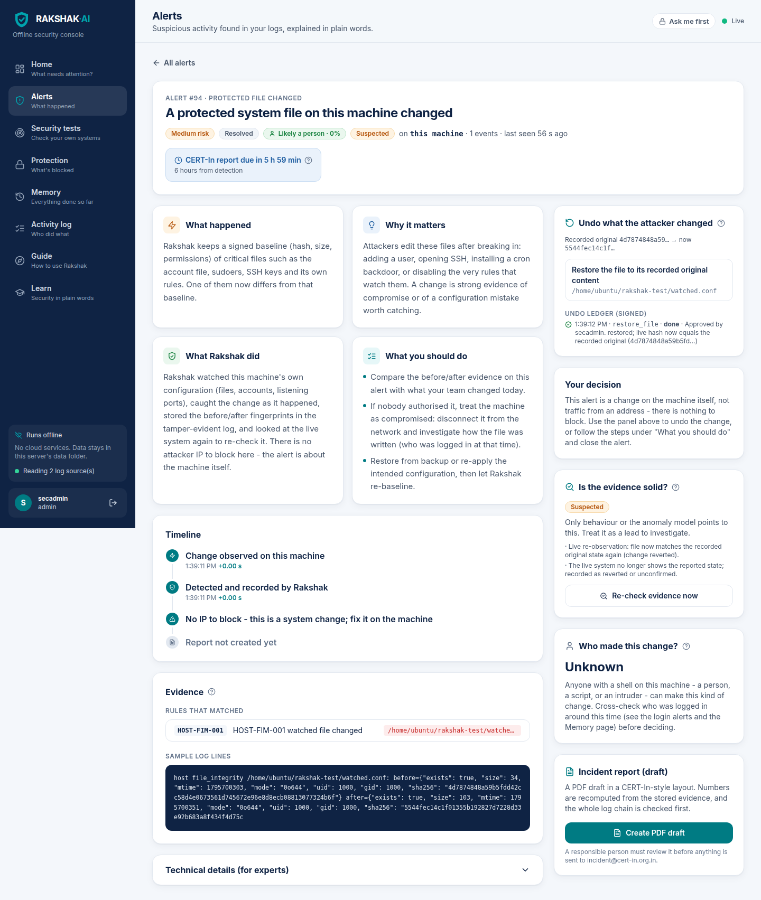

# System-security demo: persistence on the machine, detected and closed honestly

Run against the sandbox test environment on 2026-11-26 13:40 UTC (`scripts/host_security_demo.py`).
No attack traffic was needed for this one. The simulated attacker actions are real
system changes performed by us on a test machine we own: editing a watched config file
and starting a listener on 127.0.0.1:15826. The console then undid both - through its
propose -> approve -> execute -> live-verify remediation flow, not by the demo script.
The nginx/SSH side of the story (attacker IPs, approvals, firewall verification) is
covered separately in `DEMO_REALTIME_RESPONSE.md`.

## What happened, in order

| Time | Step | What we observed |
|---|---|---|
| `+   1.0s` | 0. signed in + sensor status | admin=secadmin analyst=analyst1; watching 3 files, 18 ports, 25 accounts, every 5s |
| `+   1.1s` | 1. persistence simulated | watched config edited + listener 127.0.0.1:15826 started (real socket in /proc/net) |
| `+   1.7s` | 2. file change detected + live re-checked | alert #94 rule=HOST-FIM-001 validation=evidence_checked in 0.1s |
| `+   1.7s` | 2. new listener detected + live re-checked | alert #95 rule=HOST-LISTEN-001 matched=127.0.0.1:15826 validation=evidence_checked |
| `+   1.7s` | 3. analysis: before/after fingerprints | sha256 4d7874848a59b5fd... -> 5544fec14c1f0135... (both stored, hash-chained) |
| `+   1.7s` | 3. analysis: plain-language guidance shown | title='A protected system file on this machine changed' MITRE=T1554 CERT-In='ii. Theft or leakage / unlawful exposure...' |
| `+   1.7s` | 3. honest response: no IP block is invented for a host change | executed actions so far: 0 (0 is correct) |
| `+   1.7s` | 3. instead the console offers a VERIFIED UNDO per alert | restore_file OFFERED; stop_process OFFERED |
| `+   1.7s` | 4. analyst PROPOSES the undo (nothing executed yet) | restore_file #94 status=proposed; stop_process #95 status=proposed |
| `+  49.3s` | 4. admin APPROVED; the console executed and LIVE-VERIFIED | restore_file -> done: Approved by secadmin. restored; live hash now equals the recorded orig; file on disk equals pre-attack content: True |
| `+  49.3s` | 4. same for the backdoor listener | stop_process -> done: Approved by secadmin. stopped process 55483 (python3: python3 -m http.; port refuses connections: True |
| `+  49.3s` | 4. re-check of the live machine now downgrades the alerts | file: suspected - 'Live re-observation: file now matches the recorded original ' |
| `+  49.3s` | 4. and reports the listener as gone | port: suspected - 'Live re-observation: 127.0.0.1:15826 is no longer listening.' |
| `+  51.8s` | 4. alerts closed; the record stays in Memory | resolved alerts are history, not deleted |
| `+  51.8s` | 5. Memory (system changes filter) | 20 system entries; newest: file_integrity#96; new_service#95; file_integrity#94; account_change#89 |
| `+  51.8s` | 5. evidence chain after the exercise | events ok=True audit ok=True |
| `+  58.2s` | 6. dashboard screenshots | 16_system_file_alert.png, 17_system_port_alert.png, 20_remediation_offer.png, 18_home_system_watch.png, 19_memory_system_filter.png, 21_undo_verified.png |

## The security promises this run demonstrates

1. **The agent protects the system, not just the website.** File integrity (SHA-256, size,
   permissions), accounts (new users, uid-0, sudo/wheel changes) and listening ports
   (`/proc/net`) are re-observed on a timer, offline, with no kernel modules or agents beyond
   a normal service account.
2. **Evidence, not vibes.** The alert stores the *before* and *after* fingerprints inside the
   hash-chained event log: `sha256 4d7874848a59b5fd... -> 5544fec14c1f0135...` for file `"/home/ubuntu/rakshak-test/watched.conf".
3. **Re-check means the live machine.** "Evidence re-checked" here means Rakshak re-hashed the
   file and re-read `/proc/net` again and still saw the change - after the approved undo it
   re-checked, saw the effect was gone, and *downgraded the alert instead of quietly deleting
   it*. The demo script verified the same facts independently of the console's own claims.
4. **No fake containment, and a real undo.** A changed file has no attacker IP, so Rakshak
   proposes no block and claims no containment. Instead the console now offers a **verified
   undo**: the analyst proposes, nothing changes on disk; the admin approves; the engine
   restores the file from its vault copy (or stops the listener it attributed through the
   `/proc` socket inode) and re-checks the live effect before the alert downgrades. The
   network attacker behind an intrusion remains blockable through the normal approval flow
   demonstrated in the other demo.
5. **Memory and tamper evidence.** Both findings, their validation decisions and their closure
   stay in the signed record; the integrity endpoint still verified at the end of the run.

## Honest limits seen in this demo

* The sensors see *changes and their effects*, not *who* made them - the "who" comes from
  correlating login alerts (brute force / accepted logins) around the same window.
* The baseline starts when Rakshak starts: a compromise older than the install looks like a
  normal starting point, which is why setup tells you to install on a known-good machine.
* Files readable only by root are watched by metadata (size, mtime, permissions) unless the
  service runs as root.

## Screenshots


*16 system file alert*


*17 system port alert*


*20 remediation offer*


*18 home system watch*


*19 memory system filter*


*21 undo verified*

## Reproduce it

```bash
cd /home/ubuntu/rakshak   # console running with RAKSHAK_HOSTSEC_INTERVAL=5 and
                          # RAKSHAK_FIM_PATHS=/home/ubuntu/rakshak-test/watched.conf
RAKSHAK_E2E_CREDS=/home/ubuntu/rk_test_credentials.txt \
  .venv/bin/python scripts/host_security_demo.py --i-own-this-test-environment
```
